# Ambient Home View

**For any screen. Give your screens a second life.**

The Facebook Portal that Meta abandoned. The iPad that is too slow for games
but fine for a browser. The TV nobody is watching at 6 am. Every home has a
screen sitting idle. Ambient Home View gives it one job: show the time, the
weather, the next prayer and a line worth reading, over a wallpaper that
matches the weather outside your window, and look beautiful doing it.

No app store, no account, no server of your own, no build step. Open a URL,
tap "Add to Home Screen", put the device on a stand. That's the install.

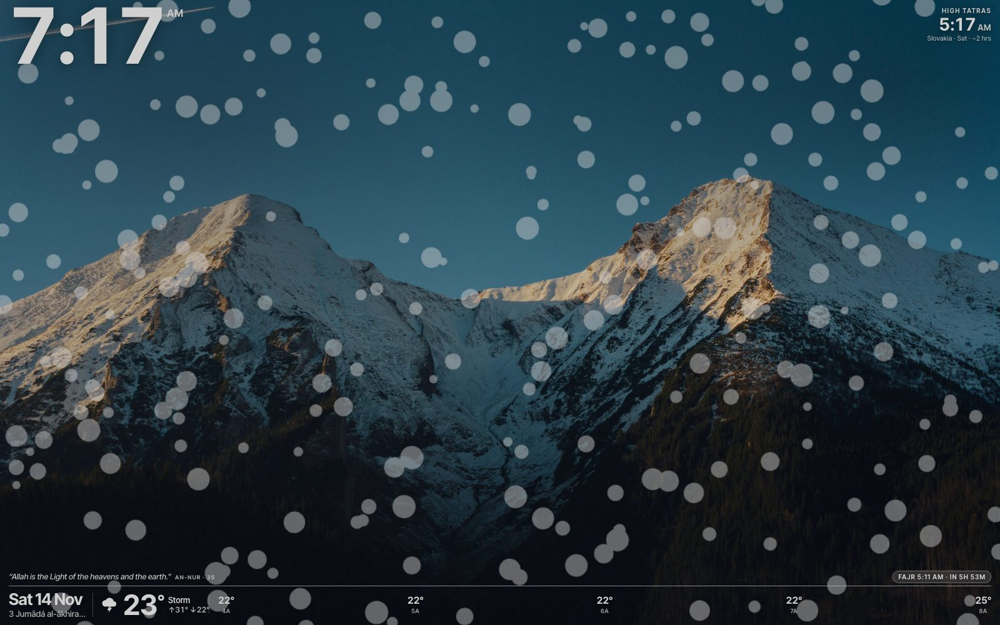

## One layout, every screen

Designed on a 512×320 Facebook Portal viewport and stretched to 4K. The same
page re-flows for landscape and portrait, phone to television, at native
pixel density. Nothing is cropped and the clock is always the first thing
you see.

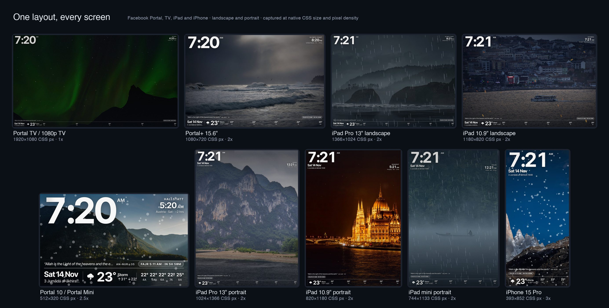

## The weather is on the screen, not just in the corner

Rain streaks, snow drifts, fog rolls, leaves fall and storms flash, drawn on
a canvas over a wallpaper chosen for that weather, that season and that hour.
The 1,800+ wallpapers are licensed photos and museum open-access art, each
vetted for quiet negative space so the clock stays legible, and text colour
adapts to every image.

| | |
|---|---|
| 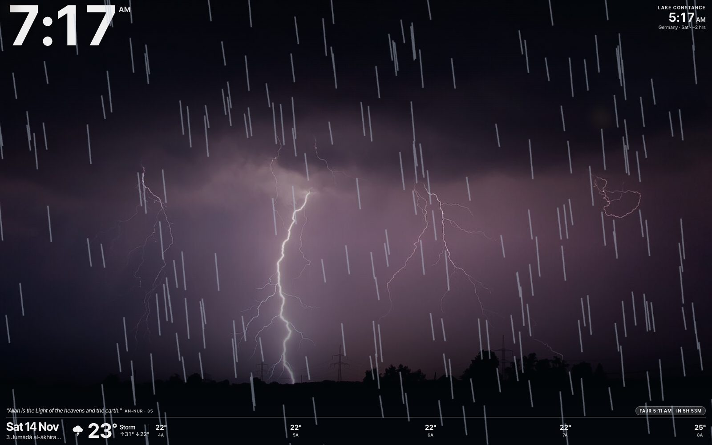 | 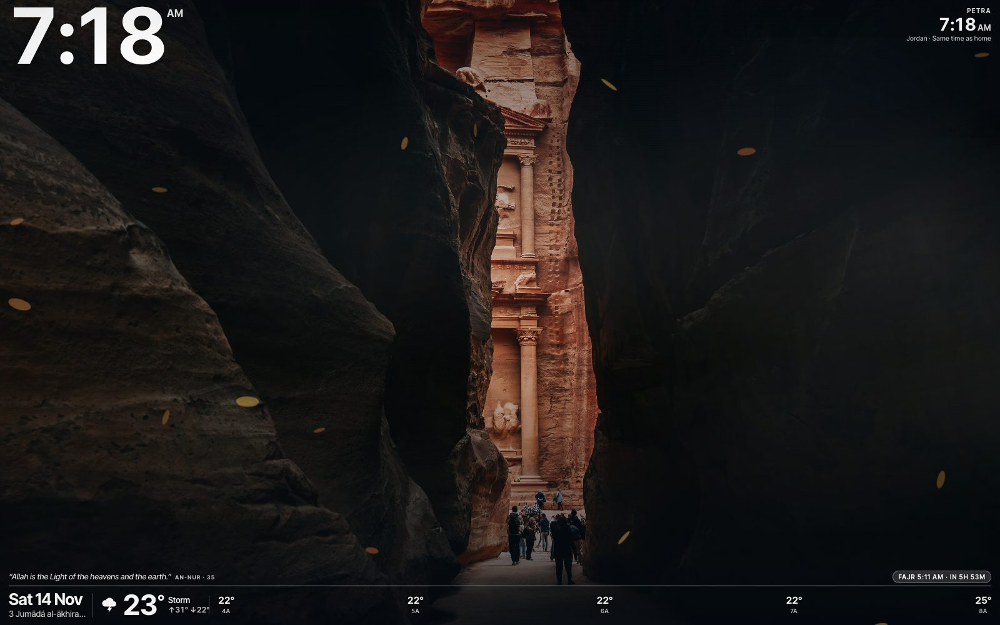 |
| *Thunderstorm: rain and lightning flashes* | *Autumn: drifting leaves* |
| 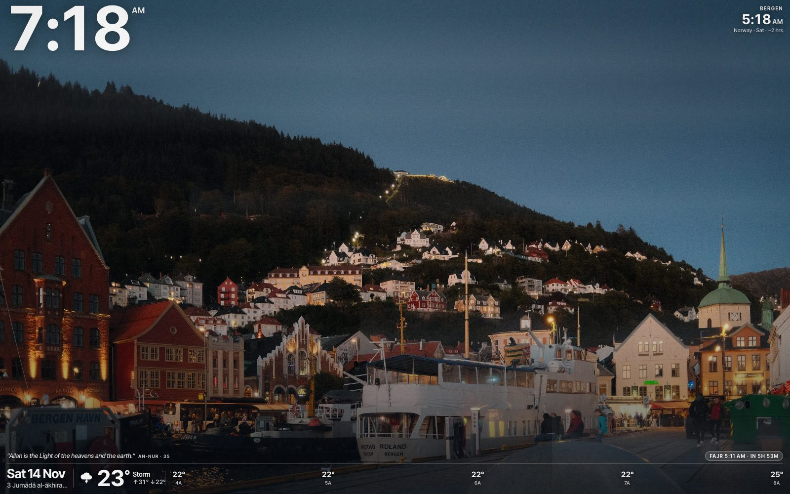 | 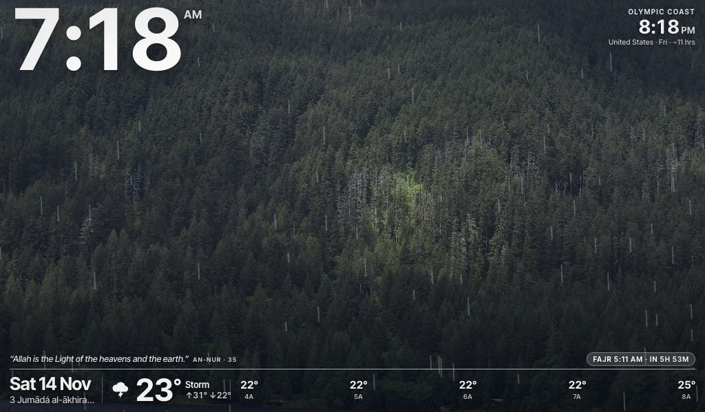 |
| *Morning fog* | *Dawn drizzle on a 1024×600 wall display* |

Portrait is a first-class layout, not an afterthought:

| | |
|---|---|
| 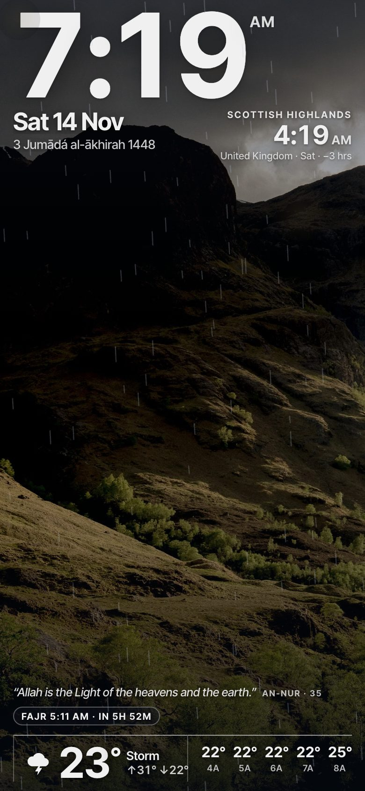 | 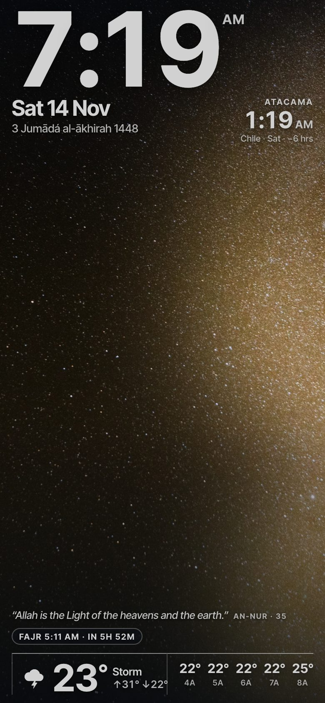 |

## Prayer times that are actually usable from across the room

A hero countdown to the next prayer, the full day's timings, the Hijri date
and an ayah of the day with its Arabic. Calculation method, Asr madhab and
high-latitude rule are all in Settings, with 23 methods from ISNA and MWL to
Umm al-Qura, Karachi and Diyanet. "Auto" picks a sensible one for your region.

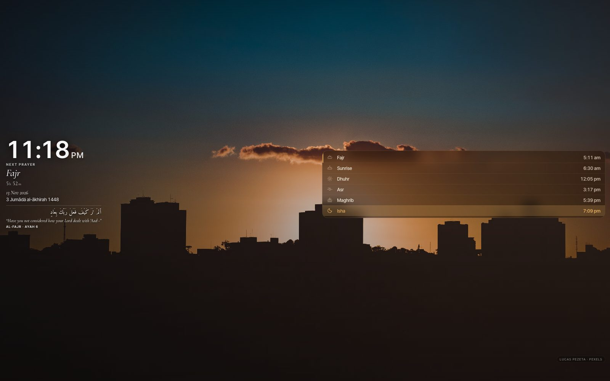

## World clocks with a sense of place

Pick the cities that matter to you. Each card shows local time, the offset
from home, whether it is already tomorrow there, and a wallpaper of that
city.

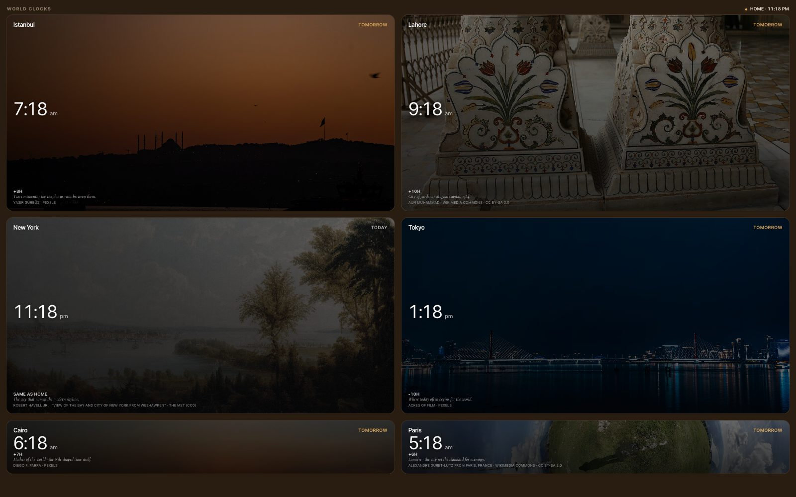

## Settings

Everything lives in one panel: overlay effects, lite mode, the photo
slideshow, page rotation, night dimming, theme and prayer calculation, plus
the credit for whatever wallpaper is on screen.

| | |
|---|---|
| 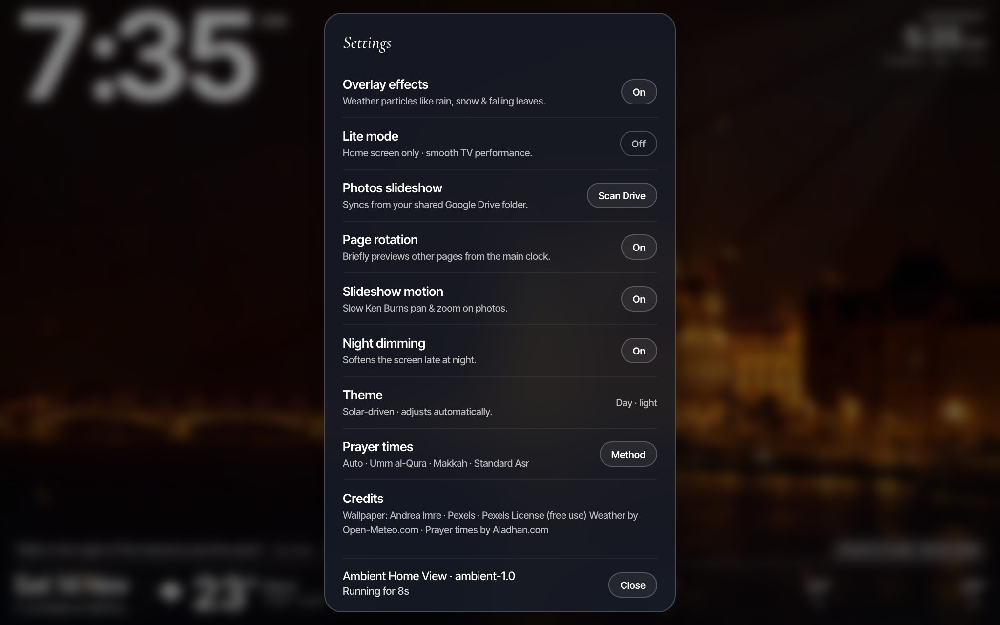 | 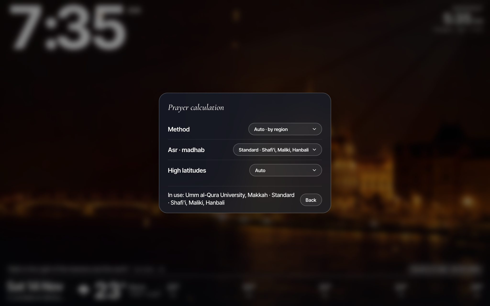 |

### Lite mode, for TVs and tired tablets

Smart TV browsers, Chromecast, Fire TV and first-generation iPads cannot
keep up with full-screen particle effects and backdrop blur. Lite mode
trims the experience to what they can draw smoothly while keeping the
look:

- Locks to the home screen; the other pages and page rotation are off.
- Fewer particles and a smaller effects canvas, with film grain and bokeh
  overlays removed.
- No backdrop blur on the dock, which collapses to a small pill.
- Pixel shift, the keep-awake video trick and the photo sync are off.

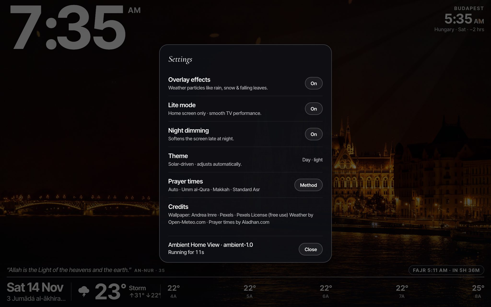

### Display care

Screens that never turn off need looking after. Ambient Home View dims itself
late at night on a solar schedule, nudges the layout by a few pixels now and
then to prevent burn-in, and keeps the screen awake using the Wake Lock API
where the browser supports it.

### Optional: a photo frame for one shared folder

Point it at one Google Drive folder and it becomes a slideshow with slow
Ken Burns motion. Anyone in the family saves a photo to that folder from
their phone and it appears on the display within about 45 minutes, or at
once from Settings → Scan Drive. The browser never holds Google credentials:
a small Cloudflare function reads the folder with a service account that
belongs to you, and that is the only permission it has.

## It knows where each screen is

Once deployed, one URL works for the whole family. Each screen shows its own
city's time, weather and prayer times, and names the city beside the
temperature: Lahore for the tablet in Lahore, Istanbul for the TV in
Istanbul, Oslo for the phone in Oslo. There is no location prompt and
nothing to configure. Cloudflare works out the city from the connection at
the edge, so it also works on TVs and smart displays that have no location
permission at all.

To pin one fixed location instead, for a wall display behind a VPN for
example, set `"autoLocate": false` under `home` in
`public/data/dashboard-content.json`.

## Run it locally

```bash
git clone https://github.com/usama-munir-ai/ambient-home-view.git
cd ambient-home-view
npm install
npm run dev
```

Open <http://localhost:3000>. Running locally there is no edge to detect
your city, so it uses the `home` entry in
`public/data/dashboard-content.json` (name, latitude, longitude, time zone).
The default is Makkah. The world clock cities live in the same file.

`npm run preview` runs the site through Cloudflare's local runtime so the
optional functions (access gate, photos) work too. Put their variables in a
`.dev.vars` file for that.

Handy preview parameters: `?wx=snow-heavy`, `?wx=thunderstorm`, `?tod=night`,
`?season=autumn`, `?mock=photos`, `?dim=off`, `?shift=off`.

## Deploy for free on Cloudflare Pages

This is a **Pages** project, not a Worker. The access gate and the photos
endpoint live in `functions/`, which only Pages runs. Cloudflare's dashboard
opens the Worker setup by default, so the one thing to get right is landing
on the Pages form.

1. Fork this repository.
2. Open the Pages setup directly:
   <https://dash.cloudflare.com/?to=/:account/pages/new/provider/github>.
   Or go to **Workers & Pages → Create** and follow the small link at the
   bottom, "Looking to deploy Pages? Get started".
3. Pick your fork and fill in the form:

   | Field | Value |
   |---|---|
   | Production branch | `main` |
   | Framework preset | None |
   | Build command | leave empty |
   | Build output directory | `public` |

4. Save and Deploy. Every push to `main` redeploys.
5. In your fork, open the **Actions** tab and enable workflows, so the daily
   wallpaper refresh keeps running. GitHub disables scheduled workflows on
   forks until you do.

If the form asks for a **Deploy command** (`npx wrangler deploy`), you are in
the Worker setup and the build will fail with "Missing entry-point to Worker
script". Go back and use the link in step 2.

To use your own domain, open the Pages project's **Custom domains** tab and
add it. Cloudflare creates the DNS record and the certificate for you when
the domain is on your Cloudflare account.

Environment variables (all optional, set under the Pages project's **Settings →
Variables and Secrets**; retry the latest deployment after changing them):

| Variable | Purpose |
|---|---|
| `ACCESS_CODE` | When set, every visitor must enter this code once; the gate runs at the edge and sets a hashed, HttpOnly cookie. Use a long code: there is no attempt limit. |
| `DRIVE_SA_JSON` | Service-account key JSON for the photos feature. |
| `DRIVE_FOLDER_ID` | The shared Drive folder to show. Required for photos. |
| `PHOTOS_ALLOW_PUBLIC` | Photos are only served when `ACCESS_CODE` is set, so a private folder never sits on an open URL. Set this to `true` only if something else, such as Cloudflare Access, already gates the site. |

The gate is a Pages Function that runs on every request, which counts toward
the free Workers quota of 100,000 requests a day. That is plenty for a
household; for a larger private audience, Cloudflare Access (free for up to
50 users) gates the site without using any function requests.

### Photos setup

1. In Google Cloud, create a project, enable the **Google Drive API**, and
   create a **service account**. Download its JSON key.
2. In Google Drive, share the photo folder with the service account's email
   address as **Viewer**.
3. Set `DRIVE_SA_JSON` to the key file's contents and `DRIVE_FOLDER_ID` to the
   id from the folder's URL.
4. Set `ACCESS_CODE` so only your household can open the site. Redeploy.

## Privacy and security

- There is no analytics, no tracking and no third-party script. The page
  talks only to the weather, prayer-time, ayah and quote APIs listed below,
  Google Fonts, and the image hosts for wallpapers.
- Shipped with a strict Content Security Policy, `nosniff`, frame
  protection and a referrer policy (see `public/_headers`).
- Location is city-level only, derived by Cloudflare from the connection.
  The site never asks for precise location and stores nothing about
  visitors. Prayer and weather requests send those city coordinates to
  Aladhan and Open-Meteo. If the city is in the United States they also go
  to the National Weather Service for storm alerts. They go nowhere else.
- Google credentials never reach the browser. The photos function reads one
  folder with a read-only scope, refuses to run on an ungated site, and
  serves only files from that folder.
- The access code is submitted by POST, so it stays out of URLs and logs.

## Wallpaper curation

`npm run curate:splash` searches the image sources, vets each candidate for
quiet negative space and legibility, and appends the keepers to
`public/data/splash-manifest.json`. The workflow in `.github/workflows` runs
it daily. Add `PEXELS_API_KEY` as a repository secret to include Pexels; the
other sources work without keys.

## Data sources and attribution

- Weather and air quality: [Open-Meteo](https://open-meteo.com), CC BY 4.0.
- Prayer times and Hijri dates: [Aladhan](https://aladhan.com).
- Ayah text and translation: [AlQuran Cloud](https://alquran.cloud).
- Storm alerts (United States only): [National Weather Service](https://www.weather.gov).
- Daily quote: [DummyJSON](https://dummyjson.com), with a built-in library as the fallback.
- Wallpapers: [Pexels](https://www.pexels.com/license/),
  [Wikimedia Commons](https://commons.wikimedia.org) (CC BY, CC BY-SA, CC0 and
  public domain, per image), and
  [The Met Open Access](https://www.metmuseum.org/about-the-met/policies-and-documents/open-access)
  (CC0). Each manifest entry records its author, licence and source URL. The
  current wallpaper's credit is shown in **Settings → Credits** and on the
  secondary screens.
- Fonts: Google Fonts, under the SIL Open Font License.

Wallpapers in the screenshots above, in order of appearance:
[Raymond Petrik](https://www.pexels.com/photo/majestic-snow-covered-peaks-in-zdiar-at-sunset-34804815/),
[Robert Pügner](https://www.pexels.com/photo/aurora-borealis-during-night-time-11685290/),
[정규송 Nui MALAMA](https://www.pexels.com/photo/grayscale-photo-of-crashing-ocean-waves-14900924/),
[Mik Dominguez](https://www.pexels.com/photo/moody-coastal-landscape-with-misty-cliff-view-31454991/),
[şüheda demirci](https://www.pexels.com/photo/ferry-boat-on-a-river-near-city-13483708/),
[Ezgi Kaya](https://www.pexels.com/photo/rocky-hills-and-lake-18875968/),
[Abdus Samad Mahkri](https://www.pexels.com/photo/stunning-karst-mountains-along-li-river-in-china-35003928/),
[Andrea Imre](https://www.pexels.com/photo/illuminated-orszaghaz-at-night-19310797/),
[Sohel Chowdhury](https://www.pexels.com/photo/serene-misty-morning-on-bangladesh-river-40772581/),
[Jose Luis Vanasco](https://www.pexels.com/photo/majestic-peaks-of-the-fitz-roy-mountain-range-37104144/),
[Mathias Krumbholz](https://commons.wikimedia.org/wiki/File:Lightning_Pritzerbe_01_(MK).jpg)
(Wikimedia Commons, [CC BY-SA 3.0](https://creativecommons.org/licenses/by-sa/3.0/)),
[Mikołaj Kołodziejczyk](https://www.pexels.com/photo/people-visiting-carved-temple-petra-jordan-16118911/),
[Dua'a Al-Amad](https://www.pexels.com/photo/twilight-cityscape-of-bergen-s-historic-harbor-34468688/),
[Jon Eliya](https://www.pexels.com/photo/pacific-northwest-27301107/),
[alleksana](https://www.pexels.com/photo/green-and-brown-mountains-under-cloudy-sky-10610150/),
[Krishna Mantripragada](https://www.pexels.com/photo/photo-of-the-milky-way-20735363/),
[Lucas Pezeta](https://www.pexels.com/photo/silhouette-of-city-buildings-during-sunset-3877443/).
All from Pexels unless noted. World clock card images are credited on the
cards.

This project is non-commercial: no ads, no subscriptions, nothing for sale.
Please keep it that way if you deploy it (see the licence) and keep the
credits visible.

## Licence

[PolyForm Noncommercial 1.0.0](LICENSE.md). Anyone, anywhere, may use,
modify and share this software for any non-commercial purpose: personal,
household, educational, charitable or religious. Commercial use is not
granted.
